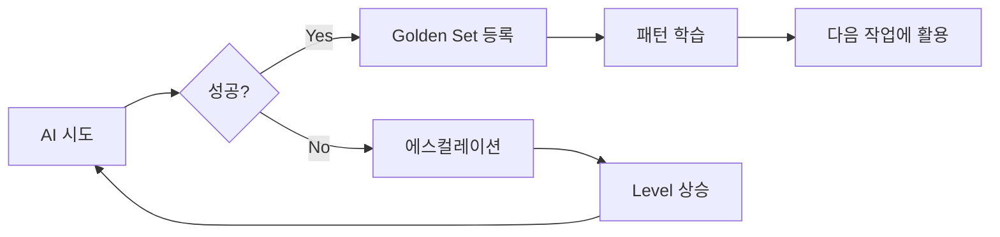

# AI 실패 시 에스컬레이션 프로세스

## 🎯 목적
PM이 직접 코드를 작성하지 않고 AI가 성공할 수 있도록 단계적 지원

## 📊 에스컬레이션 레벨

### Level 0: 초기 시도
```python
# PM → AI
"Port 인터페이스를 구현하는 Adapter를 작성하세요"
```

### Level 1: 참조 제공 (1차 실패 시)
```python
# PM → AI
"기존 ai_orchestration_adapter.py를 참고하여 
새로운 storage_adapter.py를 작성하세요"
```

### Level 2: 구체적 가이드 (2차 실패 시)
```python
# PM → AI
"""
1. OrchestratorPort 상속
2. process_issue() 메서드 구현
3. subprocess로 실제 명령 실행
4. 결과에 Provenance 추가
5. 에러 핸들링 포함
"""
```

### Level 3: 작업 분해 (3차 실패 시)
```python
# PM → 여러 AI
"AI-1: Port 인터페이스만 import하고 클래스 정의"
"AI-2: 메서드 시그니처만 작성"
"AI-3: 각 메서드 구현"
```

### Level 4: Golden Set 업데이트 (최종)
```python
# PM 판단
if 반복적_실패_패턴:
    update_golden_set()
    create_new_pattern()
else:
    request_human_intervention()
```

## 🚫 절대 하지 말아야 할 것

### ❌ PM이 직접 코드 작성
```python
# 잘못된 예
PM: "이렇게 구현하면 됩니다:
class MyAdapter(Port):
    def method(self):
        return result"
```

### ✅ 올바른 접근
```python
# 올바른 예
PM: "Port의 method를 구현하되,
기존 패턴을 참고하고
subprocess를 사용하세요"
```

## 📈 에스컬레이션 트리거

1. **타임아웃**: 120초 초과
2. **에러**: 같은 에러 2회 반복
3. **품질**: 테스트 실패
4. **무응답**: AI가 응답 없음

## 🔄 피드백 루프



## 📝 기록 및 학습

모든 에스컬레이션 사례는 기록되어:
1. 패턴 분석
2. Golden Set 업데이트
3. 프롬프트 개선
4. 시스템 진화

## 🎯 최종 목표

**"PM은 방향만 제시, AI는 자율적 구현"**

- 시간이 지날수록 에스컬레이션 감소
- Golden Set 확장으로 성공률 상승
- 진정한 AI 자율 시스템 구현